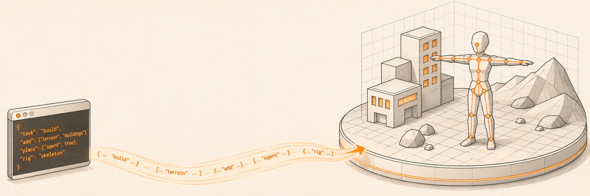
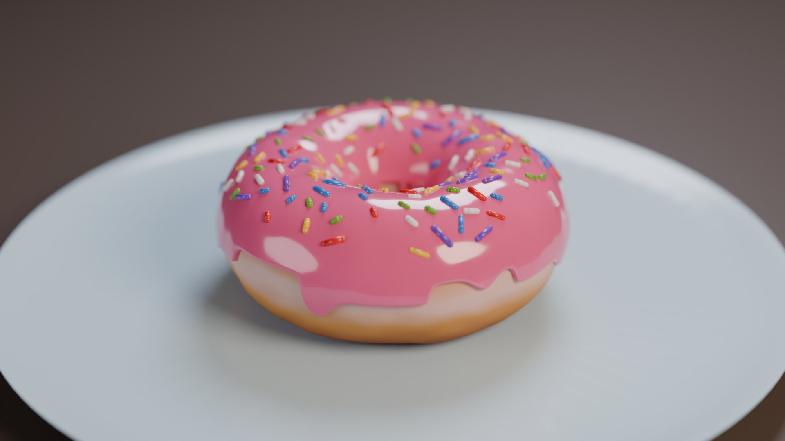
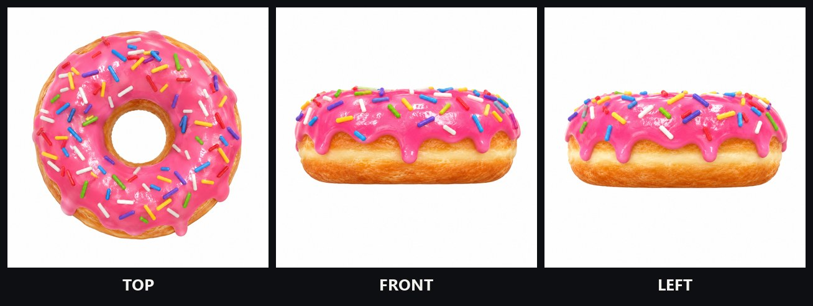
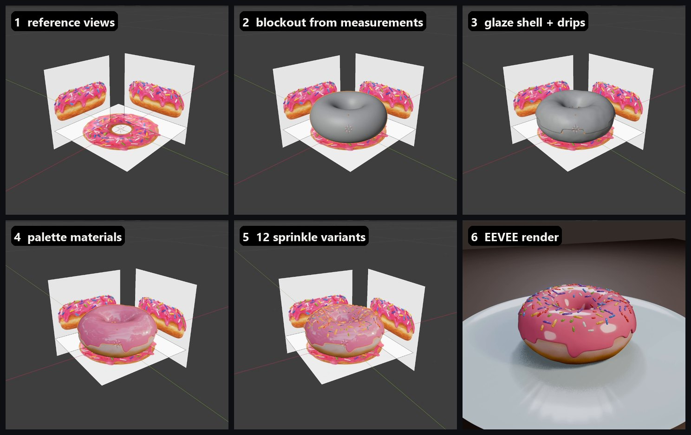
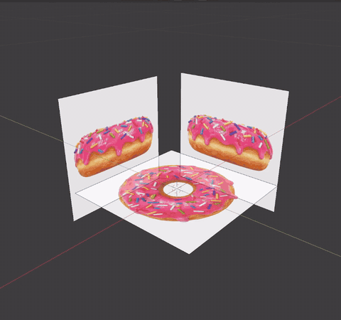
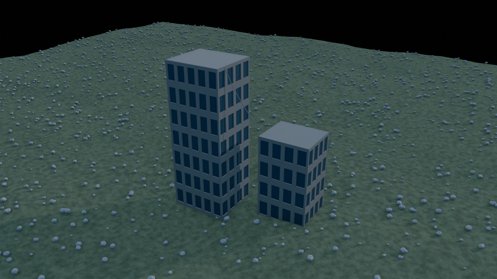
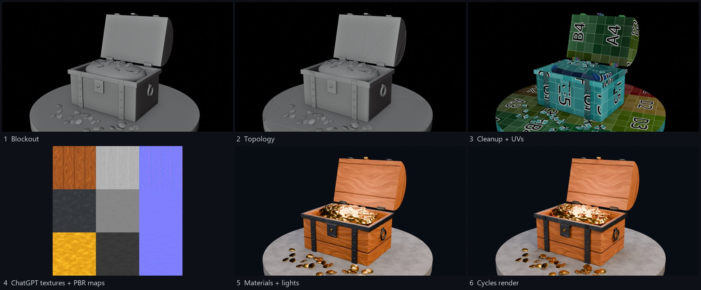
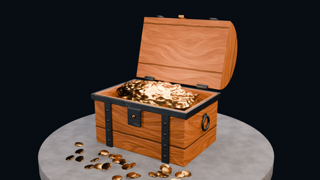

<p align="center">
  
</p>

<h1 align="center">BlendPro MCP</h1>

<p align="center">
  <b>Text-first Blender control for AI agents.</b><br>
  Scene diffs instead of screenshots, whole node trees in one call, 104 tested recipes, and MediaPipe pose understanding for characters.
</p>

<p align="center">
  
  
  
  
  
</p>

---

Most Blender MCP servers give the model two things: "run this Python" and "take a screenshot". The model then guesses an API name, runs code, takes a screenshot to see what happened, and repeats. That burns tokens on images and costs many round-trips per edit.

BlendPro is built around a different loop:

1. **Read the scene as text.** You get one compact line per object: transforms, after-modifier counts, modifiers with their key settings, materials and flags.
2. **Edit in one call.** Use batched edits, a whole material or Geometry Nodes tree as JSON, operators with their context handled, or one of 104 tested recipes.
3. **Read the diff.** Every edit returns what changed (added, removed and changed objects, datablock counts, mode), so there's no re-query.
4. **Verify with text.** Mesh topology reports, spatial relationships (what rests on what, real intersections, camera framing, ASCII maps) and API lookups against *your* Blender version.
5. **Look once.** At the end, a single small contact sheet of several auto-framed views. It also works headless.

BlendPro is a fork of [blendmcp](https://github.com/owenpkent/blendmcp), which is itself a fork of [blender-mcp](https://github.com/ahujasid/blender-mcp). It keeps their asset integrations as opt-in tools.

## How it works

<p align="center">
  
</p>

The figure draws the architecture as a bench machine:

| On the bench | In BlendPro |
|---|---|
| **Teleprinter** punching a narrow tape | The LLM agent (Claude Code, Claude Desktop or any MCP client) sends compact JSON tool calls over stdio |
| **Sorter cabinet** | The BlendPro MCP server (Python, FastMCP), which shapes requests and trims responses |
| **Lens unit** on the cabinet | MediaPipe Pose Landmarker, running in the server process |
| **Aerial** | Tripo3D API client (AI text/image to 3D, retopology, rigging) |
| **Cable**, plus a capped spare port | Newline-delimited JSON over a localhost socket: port `9877` for the open Blender window, `9878` for a headless Blender |
| **Hopper** on the drawer cabinet | The add-on's single main-thread queue (bpy isn't thread-safe) |
| **Crank** | The `bpy.app.timers` tick that drains the queue one command at a time |
| **Six drawers** | Handlers: scene/diff, node JSON, mesh and spatial analysis, recipes, render, pose lift |
| **Printed cards** on the front rail | What comes back: compact text, not screenshots |

*The figure was drawn with the "anatomy" isometric kit; `docs/figure/build.mjs` rebuilds it.*

## What you can do with it

### Featured: a donut modeled from reference images

<p align="center">
  
</p>

Instead of guessing proportions and colours, BlendPro measured them from reference images and then scored its own model against those images. Claude Code drove a live Blender window, and OBS recorded the build.

<p align="center">
  
  <br><sub>The references: top, front and left orthographic views, generated with ChatGPT image generation.</sub>
</p>

<p align="center">
  
</p>

<p align="center">
  
</p>

| Stage | How it was done |
|---|---|
| Measure | `reference_measure` read each view as text: 10.0 cm across, a 2.6 cm hole, 4.4 cm tall, and the glaze and dough colours as hex and linear RGB. `reference_details` found 112 sprinkles in the top view, with a median length of 4.9 mm (1.6–9.5 mm), a width of 1.4 mm and their colours |
| Set up | `reference_image_setup` placed each view in the scene as an Image empty at real size, aligned to its axis |
| Block out | A torus sized from those numbers, with SubD and a light Clouds displace. `reference_compare` scored it: IoU 0.949 front, 0.945 left, 0.970 top |
| Glaze and drips | The top of the dough was copied with a wavy edge, then Shrinkwrap (Outside Surface), Solidify and SubD. Seven drips of 5.5–10 mm were pulled down in edit mode with proportional editing |
| Materials | Dough and glaze colours came from the measured palette. The dough uses a normal-based ramp (pale band at the equator), a Noise multiply and a bump |
| Sprinkles | 12 variants (6 measured colours × lengths of 3.5–7.2 mm, some bent with Simple Deform), scattered with `scatter_with_min_distance` on a weight map limited to the top of the glaze |
| Score | The final model scored IoU **0.955 front, 0.960 left, 0.943 top** against the references |

The `.blend` file, the reference images and a 22 s vertical reel are in [`examples/donut/`](examples/donut). The workflow, including the prompts for generating the reference views, is in [`skill/blender/references/modeling/reference-pipeline.md`](skill/blender/references/modeling/reference-pipeline.md).

### More examples

<p align="center">
  
  <br><sub>Built and rendered headless from <b>11 recipe calls</b>: terrain, procedural material, two procedural buildings, low-poly rock, Poisson scatter, catenary cable, physical sky and sun, camera framing, render preset, render. See <code>examples/showcase_scene.py</code>.</sub>
</p>

### A textured prop, from empty scene to WebXR GLB

<p align="center">
  
</p>

Claude Code built this treasure chest through BlendPro in a headless Blender, with no window open. ChatGPT image generation (Codex CLI) made the wood, iron and gold textures; the server derived roughness and tileable normal maps from them in Python. Every stage was rendered to a still for a progress video.

<p align="center">
  
</p>

<p align="center">
  
</p>

| Stage | How it was done |
|---|---|
| Blockout | One `run_python` call: hollow body, hinged lid, straps, rim band, lock, handles, 16 rivets (linked duplicates), gold pile, 70 coins, pedestal, camera rig |
| Cleanup and UVs | `mesh_analysis` reported 196 duplicate vertices, degenerate faces, n-gons and an unapplied scale as text. The `mesh_cleanup`, `fix_ngons`, `apply_transforms` and `smart_uv_unwrap` recipes fixed them, and a second `mesh_analysis` confirmed it |
| Textures | 3 images from ChatGPT image generation; roughness and normal maps computed from them, then `pbr_material_from_textures` |
| Look | `three_point_lighting`, `set_render_preset`, EEVEE for previews, Cycles on the GPU for the hero (about 9 s per frame) |
| Review | A BVH interference check in `run_python` found coins and the gold pile passing through the lid, and the lid's bounding box showed its shell had been modelled upside down. Both were fixed from those numbers, not from screenshots |
| Ship | `xr_budget_report` for Quest: 32,304 tris (4.3%), 102 draw calls (68%), 5.3 MB of textures, all within budget. Then `export_asset(preset="webxr_glb")`: an 8.4 MB Draco GLB |

The GLB and the step log are in [`examples/treasure_chest/`](examples/treasure_chest).

**What it cost.** These numbers come from the Claude Code session log, not an estimate. The build and one round of fixes took **83 model calls** on Claude Opus 5.5:
- **57,800 output tokens**
- **174,000 tokens written to the prompt cache**
- **31.1 million tokens read back from the cache**

At API list prices that is about **$8.80**. On a Claude subscription it counts against the plan instead. About $6.20 of it is cache reads, because this session already carried a long history from earlier work. A fresh session re-reads far less on each call, so the same job costs less. Other services: 3 ChatGPT images through an existing ChatGPT plan, and 0 Tripo credits.

#### Why this uses fewer tokens than a basic Blender MCP

A basic Blender MCP gives the model "run Python" and "take a screenshot". Each edit then becomes: guess an API, run it, screenshot to see what happened, read the image, repeat. Images are the most expensive thing a model reads, and a screenshot can't show topology, collisions or budgets anyway. BlendPro replaces most of those loops with text:

| Basic MCP | BlendPro | In this build |
|---|---|---|
| Screenshot after each edit to see what changed | Every edit returns a **scene diff** as text | No viewport screenshots. Images were opened only to judge final renders |
| Look at the mesh and hope | **`mesh_analysis`** lists duplicates, n-gons, flipped normals and UV problems with fix hints | Found 196 duplicate vertices that a render would never show |
| Write cleanup and UV code from scratch, debug it | **104 tested recipes**, one call each | Cleanup, n-gon fixing, transforms, UVs, PBR materials, lights and the render preset came from recipes, with no debugging round-trips |
| Re-send state with every script | **`persist`** keeps helpers and data between calls | The snapshot helper, recipe handle and object lists were written once and reused across calls |
| Find export settings by trial | **`export_asset` presets** with a pre-export budget check | One call for a Draco GLB and the Quest budget |
| Read a traceback, guess, re-run | `run_python` returns the **failing line and a did-you-mean hint** | Each error in the session was fixed on the next call |

We haven't benchmarked a basic MCP on the same chest side by side, so this table shows where the savings come from rather than a measured ratio.

### Tools (22)

| Group | Tools | What makes them cheap |
|---|---|---|
| **Understand** | `scene_overview`, `inspect`, `mesh_analysis`, `spatial_report`, `node_tree_get`, `api_lookup` | All text. `mesh_analysis` lists n-gons, non-manifold edges, flipped normals, duplicates, poles, self-intersections, UV islands and budget checks for Quest, WebXR or Unity, with fix hints. `spatial_report` gives "on ground / on X / floating by d", true surface intersections, camera coverage and ASCII top/front maps. `api_lookup` reads operator args, node sockets and enums from the installed build. |
| **Edit** | `run_python`, `run_operators`, `edit_objects`, `node_tree_build`, `recipes` | Every call returns a scene diff. `run_python` returns your `result` value and the failing line with a did-you-mean hint. `run_operators` sets mode, selection and viewport context and explains `poll()` failures. `node_tree_build` creates or patches a whole material or GN tree and reports evaluated vert, face and instance counts. |
| **Look** | `render_views`, `viewport_screenshot` | One small contact sheet (front, right, top, iso, camera...), auto-framed on real geometry, workbench/EEVEE/Cycles, also headless. |
| **Safety & files** | `checkpoint`, `file_ops`, `blender_session` | Snapshot and roll back before destructive steps. Start a background Blender when no window is open. |
| **Pipeline** | `export_asset`, `addons` | Tested export presets (`unity_fbx`, `glb`, `webxr_glb` with Draco, `obj`, `usd`) with pre-export checks. List, enable and install add-ons, and see which operators they add. |
| **Characters** | `pose_analyze` | MediaPipe pose, described below. |
| **AI 3D (optional)** | `tripo_generate`, `tripo_process`, `tripo_task` | Tripo3D text/image/multiview to 3D, retopo, texture, rig, retarget and convert. Results import grounded and scaled. Spends your Tripo API credits. |

The asset tools inherited from blendmcp (Poly Haven, Sketchfab, Hyper3D Rodin, Hunyuan3D) add 13 more tool schemas, so they load only with `BLENDPRO_ASSET_TOOLS=1` and don't cost context otherwise.

### 104 tested recipes

`recipes(action="list" | "doc" | "run")` exposes parameterized one-call tasks. Every recipe has a headless test that runs on a fresh scene and checks a real outcome: counts, dimensions, files written, evaluated instances. **108 test cases pass on Blender 5.2.2.**

| Category | Count | Examples |
|---|---|---|
| Modeling & UV | 25 | `rounded_box`, `boolean_cut`, `lathe_profile`, `mesh_cleanup`, `apply_transforms`, `decimate_to_tris`, `smooth_by_angle`, `smart_uv_unwrap`, `texel_density`, `symmetrize` |
| Materials, lighting, render, bake | 25 | `pbr_material_from_textures` (sets colour spaces correctly), `procedural_material`, `toon_shader_material`, `three_point_lighting`, `sky_world`, `sun_time_of_day`, `frame_objects_camera`, `turntable_setup`, `bake_maps`, `bake_normal_high_to_low` |
| Rigging & animation | 25 | `biped_armature` (Blender/Mixamo/Unity names), `armature_from_joint_positions`, `auto_weight_parent`, `limit_weights_and_normalize`, `ik_chain`, `procedural_walk_cycle`, `bake_action`, `retarget_simple`, `root_motion_extract` |
| Geometry Nodes | 11 | `scatter_on_surface`, `scatter_with_min_distance`, `procedural_building`, `procedural_fence`, `cable_between_points`, `stylized_fur_cards`, `terrain_from_noise`, `realize_and_apply_gn` |
| Reference images | 4 | `reference_measure`, `reference_image_setup`, `reference_compare` (silhouette IoU per view), `reference_details` (sprinkle/seed stats) |
| XR / engine pipeline | 14 | `generate_lods`, `unity_collision_mesh`, `lightmap_uv2`, `batch_export`, `naming_convention_fix`, `xr_budget_report`, `texture_resize`, `merge_by_material`, `gltf_optimize_export` |

The full list with one-line summaries is in **[docs/RECIPES.md](docs/RECIPES.md)**.

### Character pose understanding (MediaPipe)

`pose_analyze(objects=["Character"], rest_pose=True, create="armature")` works in five steps:

1. **Render.** It renders an orthographic view of the character and runs **MediaPipe Pose Landmarker**, which finds 33 landmarks.
2. **Draw.** It draws the skeleton over the render (subject's left blue, right orange) and as lines in the 3D viewport, in front of the mesh.
3. **Lift to 3D.** It lifts every joint into 3D *at the middle of the limb*. It casts a ray through the mesh and takes the midpoint between where the ray enters and where it exits.
4. **Report.** It returns elbow and knee angles, arm elevation (T-pose or A-pose), limb lengths and left/right asymmetry, spine lean, facing direction and ankle heights.
5. **Optionally rig.** With `create="armature"` it builds a starter humanoid armature from the joints, with Blender, Mixamo or Unity bone names.

`frames=[...]` checks an animation frame by frame (joint angles, foot heights) without returning any images.

Example output on a T-posed test character (abridged):

```json
{"arm_pose": "T-pose", "facing_dir_xy": [0.05, -1.0],
 "left_upper_arm_len": 0.264, "right_upper_arm_len": 0.269, "upper_arm_len_asymmetry_pct": 1.9,
 "left_knee_angle": 171.9, "right_knee_angle": 174.3, "left_ankle_height": 0.177,
 "armature": {"bones": 19, "roots": ["Hips"]}}
```

Limits:
- **Faceless heads aren't detected.** MediaPipe's person detector keys on a face or head, so a logo or mask head fails.
- **Action frames are rough.** Twisted poses and baggy clothes give rough joints. Use `rest_pose=True` for rigging.
- **Mirrored left/right is corrected.** MediaPipe sometimes swaps sides; BlendPro corrects the labels from the known camera side.

## Install

**You need:** Blender 4.2+ (developed and tested on **5.2.2 LTS**), Python 3.10+ and [uv](https://docs.astral.sh/uv/).

```bash
git clone https://github.com/MemeGamer/blendpro-mcp.git
cd blendpro-mcp
uv tool install -e .          # installs the `blendpro` command (MCP server + MediaPipe)
blendpro install-addon        # copies the add-on into Blender's user add-ons and enables it
```

Open Blender. The **BlendPro MCP** add-on starts listening on `127.0.0.1:9877` (sidebar › BlendPro; auto-start can be turned off in its preferences).

### Connect your MCP client

**Claude Code**

```bash
claude mcp add -s user blendpro -- blendpro
```

**Claude Desktop** (`claude_desktop_config.json`)

```json
{ "mcpServers": { "blendpro": { "command": "blendpro" } } }
```

No Blender window? Ask the agent to call `blender_session(action="start_headless", blend_file="scene.blend")`. It runs a background Blender on port `9878`, and every tool then targets it.

### Optional

| Feature | Setup |
|---|---|
| Tripo3D generation | Put your API key on one line in `~/.blendpro/tripo_api_key.txt`, or set `TRIPO_API_KEY`. The key is read from there and never passes through the model. Check credits with `tripo_task(action="balance")`. |
| Poly Haven / Sketchfab / Hyper3D / Hunyuan3D | `BLENDPRO_ASSET_TOOLS=1`, then enable each in the add-on's sidebar panel. |
| MediaPipe model | Downloaded on first use to `~/.blendpro/models/` (`heavy`; `full`/`lite` via `model=`). |
| Environment | `BLENDER_EXE`, `BLENDPRO_PORT` (9877), `BLENDPRO_HEADLESS_PORT` (9878), `BLENDPRO_TIMEOUT` (600 s). |

### The companion skill (Claude Code)

`skill/blender/` is a Claude Code skill. It teaches the agent the token-cheap workflow above and adds curated Blender know-how: modeling, boolean cleanup, sculpting, materials, Geometry Nodes, stylized EEVEE, add-on operators, and a reference on **how Blender works internally** (DNA/RNA, depsgraph and evaluated copies, mesh attributes and bmesh, operator context, GN fields, layered actions, 5.x API changes). Install it by copying the folder:

```bash
cp -r skill/blender ~/.claude/skills/blender
```

## Tests

```bash
blender --background --factory-startup --python tests/run_recipe_tests.py            # all recipes
blender --background --factory-startup --python tests/run_recipe_tests.py -- rigging # one module
```

Each case runs on an empty factory scene and must return a JSON-serializable result that passes its check. The registry also reports duplicate recipe names.

## Project layout

```
src/blendpro/
  server.py            MCP tools (FastMCP), socket client, headless spawning
  posedetect.py        MediaPipe Pose Landmarker + skeleton overlay
  tripo.py             Tripo3D API v3 client
  assets.py            blendmcp asset tools (opt-in)
  install.py           `blendpro install-addon`
  addon/               the Blender add-on (copied into Blender by install-addon)
    __init__.py        socket server: timer queue (GUI) / blocking loop (headless), panel, prefs
    scene.py           overview, inspect, snapshot + diff
    nodes.py           node-tree JSON read/write
    analysis.py        mesh topology + spatial report
    render.py          contact-sheet renders, screenshots
    ops.py             python, operators, batched edits, checkpoints, API lookup, add-ons, export
    pose.py            pose render + 3D joint lift + metrics
    imports.py         normalized model import, Tripo Bridge status
    recipes/           104 recipes (modeling, shading, rigging, pipeline, reference)
    legacy_blendmcp.py blendmcp handlers for the asset integrations
    headless_runner.py background-mode server
tests/                 recipe tests + runner
skill/blender/         Claude Code skill + references
examples/              showcase_scene.py
docs/                  RECIPES.md, images, figure source
```

## Security

Like every Blender MCP, BlendPro **executes Python sent by the model inside Blender**.
- The socket binds to `127.0.0.1` only.
- API keys are read from local files or environment variables, never from tool arguments.
- Don't enable the web asset tools on untrusted prompts. Asset names and descriptions fetched from the web are a prompt-injection path into code execution.

## Credits

- **[blendmcp](https://github.com/owenpkent/blendmcp)** by Owen Kent and **[blender-mcp](https://github.com/ahujasid/blender-mcp)** by Siddharth Ahuja (MIT). The socket add-on design and the asset integrations come from these. See `LICENSE-blendmcp`.
- **Design references:** other open-source Blender MCPs, notably Blender Lab's `blender_mcp` (headless mode, API search) and `dcc-mcp-blender` (node graphs, validation). No code was copied from GPL projects.
- **Libraries and services:**
  - [MediaPipe](https://github.com/google-ai-edge/mediapipe) (Apache-2.0) for pose landmarks.
  - The Tripo3D API, a third-party paid service.
- **Images:**
  - Banner: generated with ChatGPT image generation (via the Codex CLI).
  - Architecture figure: drawn with the "anatomy" isometric figure kit.
  - Showcase: rendered by BlendPro itself.

## License

[MIT](LICENSE) © 2026 Varun VP
