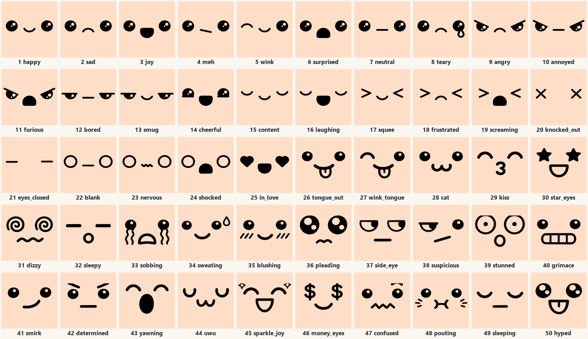

# Cute 2D face expressions (texture-swap faces)

For stylised characters (mascots, chibi, blob creatures, toys), a 2D face on a decal often reads better than a modelled face. It's also cheaper: a single draw call, no face rig, and it works the same in Blender, Unity and WebXR. BlendPro ships 50 faces and a rig that swaps between them with one integer.



## Quick use (BlendPro recipes)

```text
recipes run face_expression_setup   {target: "Head", expression: "happy"}
recipes run face_expression_set     {decal: "FaceDecal", expression: "angry", frame: 48}
recipes run face_expression_animate {decal: "FaceDecal", keys: [[1,"happy"],[40,"surprised"],[70,"laughing"],[110,"happy"]], blink: true}
```

**`face_expression_setup`** builds the face. It:
- puts a subdivided plane on the front (−Y side) of the head, centred on the eye line (`height`, a fraction of the head height)
- projects the plane onto the surface with Shrinkwrap (Project, both directions), set `offset` above it
- parents the plane to the head
- gives it a material that reads the decal's custom property **`expression`** through an Attribute node (Object type)

That means no drivers are needed, and it renders the same in EEVEE and Cycles.

**Size** defaults to the head width, and the features fill about 60% of it. Use a smaller `size` for a small face on a big head.

**Offset** defaults to 0.6% of the head width. Don't push it to 0: the head's facet edges then poke through as tiny skin-coloured specks.

**Expressions** are set by name, by tag (for example `blink`, `talk`, `tears`) or by index. Names live in `assets/faces/faces.json`.

**Keyframes** are inserted with **CONSTANT** interpolation, because faces must pop, not blend. An int property on Bézier curves would step through the faces in between.

**Blinks** come from `face_expression_animate`. Each face can name a `blink` partner, the same face with closed eyes:

| Face | Blink partner |
|---|---|
| happy | content |
| joy | laughing |
| surprised | laughing |
| neutral | eyes_closed |

Faces without a partner aren't blinked, and no blink is placed within 6 frames of an expression change.

**`face_atlas_build`** packs every face into one atlas, 8 columns × 256 px per face (2048 × 1792 for 50 faces), with 8 px padding so mipmaps don't bleed. The atlas is packed into the .blend.

## The 50 faces

| # | name | # | name | # | name | # | name | # | name |
|---|---|---|---|---|---|---|---|---|---|
| 1 | happy | 11 | furious | 21 | eyes_closed | 31 | dizzy | 41 | smirk |
| 2 | sad | 12 | bored | 22 | blank | 32 | sleepy | 42 | determined |
| 3 | joy | 13 | smug | 23 | nervous | 33 | sobbing | 43 | yawning |
| 4 | meh | 14 | cheerful | 24 | shocked | 34 | sweating | 44 | uwu |
| 5 | wink | 15 | content | 25 | in_love | 35 | blushing | 45 | sparkle_joy |
| 6 | surprised | 16 | laughing | 26 | tongue_out | 36 | pleading | 46 | money_eyes |
| 7 | neutral | 17 | squee | 27 | wink_tongue | 37 | side_eye | 47 | confused |
| 8 | teary | 18 | frustrated | 28 | cat | 38 | suspicious | 48 | pouting |
| 9 | angry | 19 | screaming | 29 | kiss | 39 | stunned | 49 | sleeping |
| 10 | annoyed | 20 | knocked_out | 30 | star_eyes | 40 | grimace | 50 | hyped |

Faces 1–25 are the original hand-made set. Faces 26–50 were generated with GPT image generation, using the original sheet as a style reference, then imported with `face_sheet_import`.

**Talking:** alternate a closed-mouth and an open-mouth face on syllables, for example happy ↔ joy, neutral ↔ surprised, or cheerful ↔ joy, every 3–5 frames.

## Layout spec (so any new face swaps cleanly)

- **Canvas:** 1024 × 1024 PNG with a **transparent background** and **pure black** ink. Highlights and teeth are transparent holes, so the skin shows through. To get coloured features, change `feature_color` on the material; don't recolour the PNGs.
- **Eyes:** centred at **y ≈ 516**. The left eye is around x ≈ 150–365 and the right eye around x ≈ 659–872. A dot eye is **about 205 px wide**.
- **Mouth:** centred at x = 512, roughly y 540–690.
- **Margins:** keep everything inside about 150–875 px horizontally. Use the face's own margins rather than letting features touch the canvas edge.

## Making more faces with image generation

1. Generate a **grid sheet**, not single faces, so every face shares one scale. Attach an existing sheet as the style reference: for example the catalog image, or a 5×5 contact sheet of your current faces. Prompt pattern:

```
The attached image is a style reference: a 5x5 sheet of cute kawaii face expressions drawn as solid flat
BLACK geometric shapes (round dot eyes with small white highlight dots, simple arc or D-shaped mouths,
thick rounded strokes) on a plain WHITE background, each face centred in its own square cell.
Create a NEW square sheet in exactly the same style: a 5x5 grid of 25 cells separated by thin light-grey
grid lines, plain white cells, NO numbers, NO text, no colour, no grey shading. Every face uses the same
layout: left eye, mouth in the middle slightly lower, right eye, in one horizontal band across the middle
of the cell, same sizes and stroke weight as the reference. Only these 25 expressions, in this order:
1 <expression: eyes ..., mouth ...>
...
Square image, high resolution.
```

   - **Through Codex CLI**, pipe the prompt on stdin so `-i` doesn't treat it as a file name:
     ```
     codex exec --skip-git-repo-check -s read-only --ephemeral -i reference_sheet.png < prompt.txt
     ```
     The image lands in `~/.codex/generated_images/`.
   - **Without a linked account**, give the user the prompt to paste into ChatGPT along with the reference image.

2. `recipes run face_sheet_import {sheet_path, start_index: 51, rows: 5, cols: 5}` then:
   - cuts the sheet into cells and turns dark ink into opaque black, with white becoming transparent
   - applies **one** scale and offset to the whole sheet, so the median left-eye width becomes 205 px and the eye row lands at y = 516
   - centres each face horizontally

3. Add `{name, tags, blink}` entries for the new indices to `faces.json`, then re-run `face_expression_setup`. That rebuilds the atlas.

**Review step:** look at the imported faces over a skin colour, as one contact sheet. Generated sheets sometimes merge two expressions, add stray text, or draw a shadow. Regenerate a cell rather than hand-fixing it.

## Engine notes

- **Unity / WebXR:** export the atlas (the file path is in `face_atlas_build`'s result) and animate the material's UV offset. For face index *i* (1-based) with `cols` columns and `rows` rows:
  - `offset = ((i-1) % cols / cols, (rows-1-floor((i-1)/cols)) / rows)`
  - `tiling = (1/cols, 1/rows)`

  In glTF, bake each expression to a separate material, or drive the `KHR_texture_transform` offset.
- **Shadows:** keep the decal's own shadow off (`visible_shadow = False`, which setup does) so the plane doesn't cast a square shadow.
- **Outline or toon shading:** the decal is a separate object, so exclude it from inverted-hull outlines.
