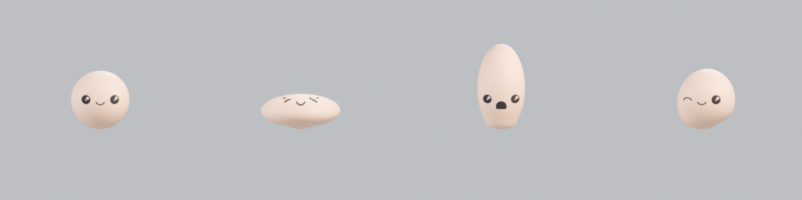

# Squash & stretch rig (Stretch To + Bendy Bones)

Notes from Into Animation's "Simple Squash and Stretch | Blender Rigging Tutorial", checked against Blender 5.2. The rig suits bouncing balls, blobs, mascots and cartoon props. One recipe builds it: `squash_stretch_rig`.



## 1. Plan first
Decide where the pivot goes before placing bones. For anything that bounces or sits, that's the **base**. Also decide how the volume should behave when the object squashes. Planning saves rebuilding the armature halfway through.

## 2. Bones
| Bone | Parent | Deform | Job |
|---|---|---|---|
| `root` | none | no | Moves, turns and places everything. Lies flat at the base |
| `bottom` | root | **yes** | Base control. The base vertices are weighted 1.0 to it, so they stay planted |
| `body` | bottom (connected) | **yes** | The B-Bone that squashes and stretches |
| `top` | **root** (not body) | no | Its position drives the stretch, its rotation drives the bend |

The key point is that `top` must **not** be a child of `body`. Use `Alt P → Clear Parent` in Edit Mode, then parent it to `root`, so it can move freely and pull the body.

## 3. Stretch To
- On `body`, add a **Stretch To** constraint with Target = the armature and Bone = `top`. Moving `top` now stretches or squashes `body`.
- **Volume:** XZ, X, Z or None.
  - `VOLUME_XZX` (shown as "XZ") preserves volume on both side axes.
  - **Volume Variation** (`bulge`) sets how strongly it bulges.
  - **Volume Min/Max** clamp the bulge.
- After moving bones in Edit Mode, press **Reset** on the constraint's Rest Length. If you don't, the rig starts already squashed or stretched.

## 4. Bendy Bones
1. Set the armature's Viewport Display to **B-Bone**.
2. On `body`, go to `Bone → Bendy Bones` and set **Segments** to 4–8.
3. For smooth C-curves when `top` moves sideways or rotates, set the B-Bone **Start and End Handle** type to **Absolute**, with `bottom` and `top` as the handle bones.

## 5. Controls, shapes and collections
- **Custom shapes:** under `Bone → Viewport Display → Custom Shape`, use circles for root, bottom and top. Keep the shape meshes in their own excluded or hidden collection.
- **Bone Collections** (Blender 4.0+): put the controls in **CONTROLS** and the B-Bone in **DEFORM**, then hide DEFORM.

## 6. Rotation order (corrected)
The original notes get this backwards.

In Blender, `XYZ Euler` applies **X first and Z last**, which equals `Rz @ Ry @ Rx`. So the **last** letter is the outermost axis, the one that never gimbal-locks. Gimbal lock happens when the **middle** axis reaches ±90°.

The rules:
- **Last letter:** the axis the control rotates around most.
- **Middle letter:** the axis it rotates around least.
- For an upright bone, the least-used axis is usually the local Y twist.

For a control that mostly tilts forward and back around its local X:
- **`ZYX`** is right: X is outermost and the Y twist is in the middle. The recipe uses this.
- `XZY` is wrong for this case: it puts Y outermost and X innermost.

## 7. Skinning and weights
1. Select the mesh, then the armature, and press `Ctrl P → With Automatic Weights`.
2. In Weight Paint mode, `Ctrl Click` a bone to see its influence. Blur the transitions along the B-Bone segments.
3. Paint the **lowest vertices 1.0 on `bottom`**, so the base stays on the floor while squashing.

## 8. Finish
Use the N panel to lock the channels animators shouldn't touch:
- scale on all controls
- location on any bone that should only rotate

Then test the extremes: a big squash, a big stretch and a side bend.

## Driving it with BlendPro
```text
recipes run squash_stretch_rig {target: "Mascot", segments: 6, volume: "VOLUME_XZX", bulge: 1.0, base: 0.12}
```
In one call, the recipe:
- builds the four bones
- adds Stretch To with the rest length set
- sets up the B-Bone with Absolute handles on bottom and top
- adds circle widgets in an excluded `WGT_<rig>` collection
- creates CONTROLS and DEFORM collections, with DEFORM hidden
- sets ZYX rotation order and locks scale on the controls
- binds the mesh with automatic weights (`auto_weight_parent`)
- pins the bottom `base` fraction of the mesh to `bottom`

Its test pulls `top` down 30% and checks that the mesh gets more than 20% shorter, more than 5% wider, and that its base doesn't move.

**Bounce animation:** keyframe the `top` and `root` locations with `keyframe_transform`.
1. Squash on contact: pull `top` down.
2. Stretch on the way up and down: push `top` up.
3. Ease in and out at the apex.

**Cute faces:** `face_expression_setup` on the same mesh adds a swappable face (see `face-expressions.md`). Its Shrinkwrap decal follows the squashed surface.

## Furry squash & stretch character (tested build: fluffball)
The order matters. Build the rig, then the face, then the fur.

1. **Rig:** `squash_stretch_rig` on the body mesh.
2. **Face:** `face_expression_setup` on the same mesh.
   - When the head has an Armature modifier, the decal copies the nearest head vertex weights and gets the same Armature modifier (`follow_rig`), so it squashes, hops and twirls with the body.
   - The recipe measures the head in the **rest pose**. Without that, a posed or animated rig would put the face where the ball currently is.
3. **Fur:** particle hair on the body, added **after** the Armature modifier so the strands follow the deformation.
   - **Face readability:** don't make a bald patch, because that looks like a mask. Shorten the fur under the face with a length vertex group (about 40%), and lift the decal *above* the fur with Shrinkwrap `offset` ≈ 0.5 × hair length. The face then sits on the fluff like a printed patch.
   - **Fluffy, not felt:** `roughness_1` ≈ 0.06, `roughness_endpoint` ≈ 0.12, `clump_factor` ≈ 0.5, `child_length_threshold` ≈ 0.35 for uneven tips, and Interpolated children ×40. Add a **rim light from behind with shadows off**, so the fuzzy silhouette catches light without a second shadow.
   - **Hair dynamics on a fast squash rig:** with default settings the strands flop under gravity and sink *inside* the body, where they're hidden, so the ball looks bald after a few frames. Use:
     - gravity at about 0.05, on both `settings.effector_weights` and `cloth.settings.effector_weights`
     - `pin_stiffness` ≈ 6
     - `bending_stiffness` ≈ 10
     - `quality` ≈ 10
     - `air_damping` ≈ 2

     To check, step frames *in order* and measure the share of strand tips inside the body radius with `particle_system.co_hair`. It should stay under about 20%.
   - **Simulations need frame order:** stills rendered out of order show stale hair.
   - **Bake to disk before a command-line render.** A .blend saved with a stale *in-memory* cache rendered bald from frame ~90 on.
     1. Set `point_cache.use_disk_cache = True`.
     2. Run `bpy.ops.ptcache.bake(bake=True)` inside `temp_override(point_cache=...)`.
     3. Save, then `blender -b file.blend --render-anim`.
   - **Rig-driven faces use Nearest Surface Point** Shrinkwrap (the recipe sets it). Project along the decal's fixed axis pushed the face off the side during a twirl.
4. **Animate:**
   - Keyframe `root` (hop arcs: VECTOR handles at launch and contact, AUTO_CLAMPED at the apex) and `top`.
   - The `top` beats are: anticipation squash −0.24, launch stretch +0.30, apex 0, fall stretch +0.26, contact squash −0.36, overshoot +0.09, settle.
   - For a twirl, key the root's Z rotation 0 → 180 → 360°, then **hold 360°**. Later keys at 0° would spin it back.
   - Add `face_expression_animate` keys per beat (squee on contact, joy on launch, star_eyes at the apex).
5. **Keep the face readable over fur (compositing).**
   - **Why:** fur flops over the face on hard landings, and no length map fully prevents it.
   - **Collections:** put the decal in its own collection, together with a **fur-less copy of the body** (same mesh and Armature modifier, particle system removed) in a child collection.
   - **View layers:**
     - "Main": the decal collection excluded.
     - "Face": everything else excluded (keep the rig and camera in a shared collection), with the occluder child set to **holdout**. The face then hides correctly when it turns away.
   - **Shrinkwrap:** point the decal's Shrinkwrap at the occluder, with a small offset (about 0.02).
   - **Compositor:** turn on `film_transparent`. In Blender 5.x the compositor is a node group assigned to `scene.compositing_node_group`, with a Group Output (there's no Composite node).
     1. Alpha Over the sky colour (world colour × strength) under the Main layer.
     2. Alpha Over the Face layer on top of that.
6. **Face-friendly motion:**
   - Turn **motion blur off**: it smears thin face lines on fast squashes.
   - Keep the contact squash around **−0.22**, not −0.36. Extreme squash flattens the face into a line.
   - Use bold faces on contact frames (`laughing` reads better than thin `squee` lines).
